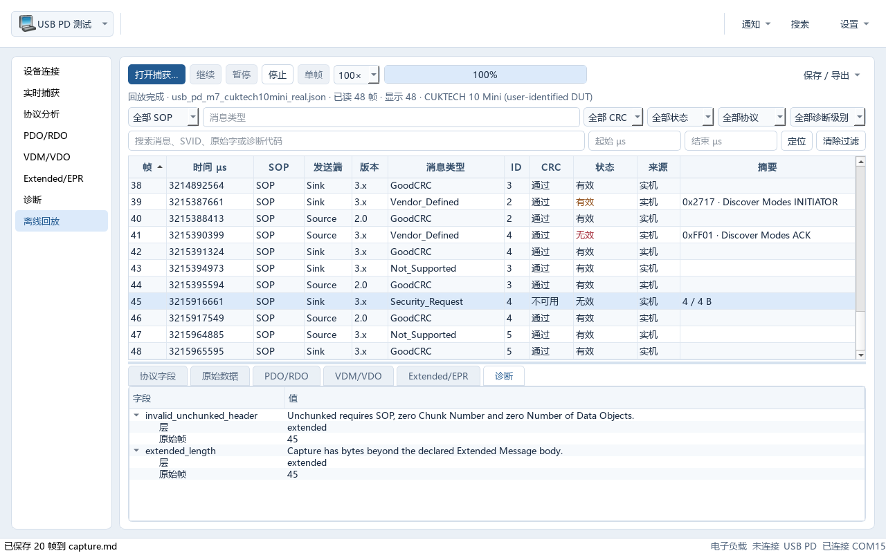

# 电子负载与 USB PD 综合测试平台第三阶段验收报告

验收日期为 2026 年 11 月 26 日。依据《第三阶段 PySide6 实施计划书 V1.2 模块切换版》，在 M7 基线 `20c9a6d` 上完成第三阶段上位机实现。

## 结论

模块切换、DRPD 实时捕获、协议展示、诊断定位、离线回放和导出通过软件回归。已用 COM15 上的 DRPD 完成捕获、保存、回放及正常断开与重连。实机运行覆盖 USB PD 链路和切回电子负载界面后的后台采集。双设备实机并行、捕获时物理拔出和 EPR 实机协商仍待补测。

| 计划项 | 验收证据 |
| --- | --- |
| P3-01、P3-11 主窗口与模块切换 | 沿用原电子负载的 Fusion 主题、颜色、字体和布局。顶部下拉、状态栏以及工作区恢复通过 GUI 验证。后台采集中反复切换，DRPD 串口保持单次打开。 |
| P3-02 设备管理 | 实机读取标识、固件、10 ns 周期和 Sink 状态，验证正常断开和重连。自动化用模拟 CDC 覆盖端口占用和意外移除。 |
| P3-03、P3-04 实时捕获和报文列表 | 实机回读捕获开关，实时显示并在停止时排空设备队列。自动化核对清空表格后仍可导出完整原始捕获。 |
| P3-05、P3-06 协议详情和专项 | 回放酷态科 10 号充电器 Mini 样本，查看 PDO/RDO、VDM/VDO、Extended 和原始字节。构造样本回放覆盖 EPR 分块与请求关联。 |
| P3-07 过滤与诊断 | 通过 RDO 原始值检索和诊断代码定位原始记录，异常 Security_Request 仍可展开原始字节，重组结果为空。 |
| P3-08、P3-09 回放与导出 | 通过逐帧、暂停、继续和文件错误恢复测试。GUI 导出原始捕获、CSV、解析 JSON 和 Markdown。重新在 GUI 回放原始文件，111 条记录的帧号、时间戳、消息名和载荷与导出结果一致。 |
| P3-10 稳定性 | 实机后台运行约 1 分钟，离线高密度回放 12,000 条。原电子负载上位机回归、纯 Python 协议回归和 Qt 服务集成测试通过。 |

## 实机捕获与性能

DRPD 复刻板为 COM15，固件 `1.0.0-beta.1`，状态 `PE_SNK_READY`。应用启动捕获前和退出实机测试后均读回捕获开关 OFF。设备 EPR 配置回读为 ON，固件 EPR PDO 缓存为 0，本轮捕获未观察到 EPR Source Capabilities。

| 场景 | 观察结果 |
| --- | --- |
| 电子负载工作区前台，DRPD 后台捕获 | 60.53 秒，发送 10 次源能力查询，归档 111 条记录。主机 CRC 错误 0，诊断 2 条。 |
| 实机采集时的主线程定时器 | 20 ms 定时器，最大采样间隔 25.0 ms。 |
| 实机原始捕获和导出 | 原始捕获 139,578 B、CSV 8,354 B、JSON 1,646,570 B、诊断 Markdown 1,524 B。原始文件读回与捕获计数一致。 |
| 12,000 条构造记录连续回放 | 2.12 MB 原始文件，约 6.01 秒，表格保留 4,000 条并计入滚出的 8,000 条。 |
| 大文件回放的主线程定时器及工作集 | 20 ms 定时器最大采样间隔 60.8 ms。单次 Windows 进程工作集从 114.2 MiB 增至采样峰值 126.1 MiB。 |

实机的两条诊断均来自第 59 帧 PS_RDY，代码为 `firmware_decode_failed` 和 `message_length`。CRC 错误计数统计主机确认的错误，捕获中还可能存在 CRC 不可用的记录。轮询等待界面确认时有背压日志。固件未提供捕获丢包总数，此轮数据可以核对主机已归档帧，无法量化物理链路漏捕数。

一分钟实机捕获及导出保存在仓库根目录下的 `tmp/p3-hardware-221718/`。末轮界面复核再次采集 20 条，设备队列峰值为 10 条，同轮保留工作区截图。 [工作区实测截图](P3_WORKSPACE_DESIGN.md)

## 协议展示

| 验证数据 | GUI 回放结果 |
| --- | --- |
| M7 实机样本第 3、5、7、9 帧 | 显示 5 个 Fixed PDO、2 个 PPS APDO，Request `0x1144B12C` 关联 PDO 1（5 V、3 A 的请求），后续显示 Accept、PS_RDY。 |
| 第 13、17、19、21、25、29 帧 | 显示 Source_Capabilities_Extended、Status、Get_Manufacturer_Info、Not_Supported，Revision `0x31180000`，Source_Info `0x80787878`。 |
| 第 33、37、41 帧 | Identity VID `0x2B01`，Discover SVIDs 含 `0x2717`，Modes 响应 `0xFF01` 和 VDO `0x00000405`，保留 `vdm_discovery_response_mismatch`。 |
| 第 45 帧 Security_Request | 标为无效，显示 `invalid_unchunked_header` 和 `extended_length`，保留原始字节 `88 A8 04 00`。 |
| 第二阶段构造样本 | 首个 EPR 分块可以标记已观察到能力通告，有效 EPR PDO 数在重组前为 0。完成重组后为 2，EPR AVS 请求解析为 4.25 A。 |

界面分别显示设备 EPR 配置、观察到的能力通告、有效能力数量和请求关联状态。PDO 与 RDO 的电压电流为链路通告和请求值。 [M7 实机样本](../../tests/fixtures/usb_pd_m7_cuktech10mini_real.json)

## 回归与待补测项目

- 全量 168 项测试包含第二阶段原有 159 项。纯 Python 118 项包含原有 114 项和新增 4 项服务测试，使用 `python -S` 运行并核对没有加载 PySide6。
- 电子负载的主窗口、命令协议和曲线记录通过自动化回归。本轮只有 DRPD 参与实机测试，电子负载 CDC 并行、电压采样和恒流控制沿用实际硬件条件另行验证。
- 意外移除与恢复状态通过模拟 CDC 验证。实机完成正常断开和重连，物理拔出仍需人工操作验证。
- 已有实机样本未出现 EPR 能力通告。有效分块及 EPR 请求关联以构造样本覆盖，待接入支持 EPR 的设备确认实机链路。当前稳定性结果覆盖本报告记录的时长和数据规模。

[第三阶段架构](P3_ARCHITECTURE.md) · [GUI 需求](P3_UI_REQUIREMENTS.md) · [接口清单](P3_API_INVENTORY.md)
