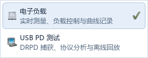
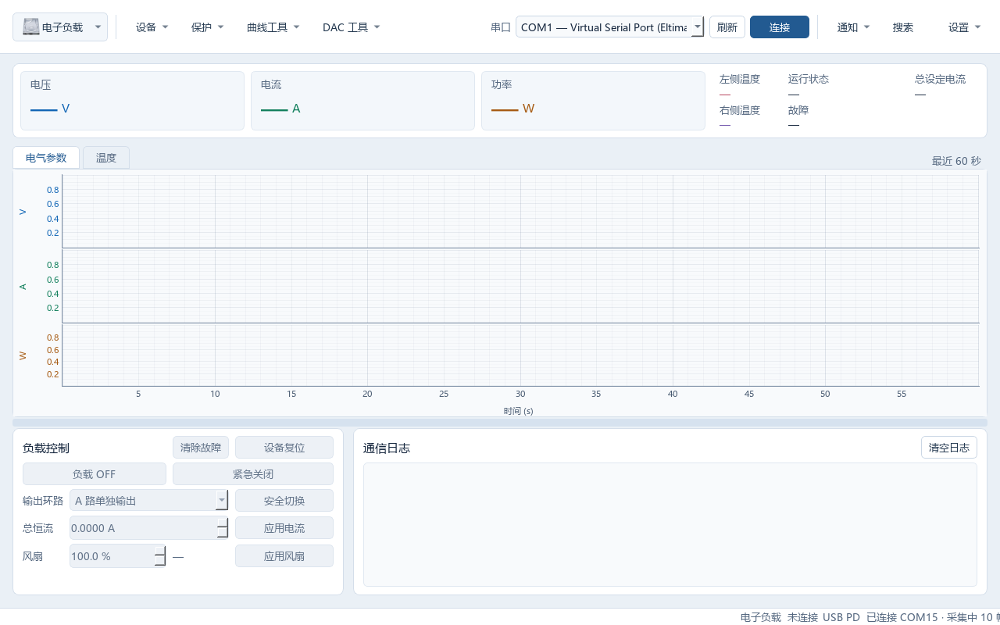
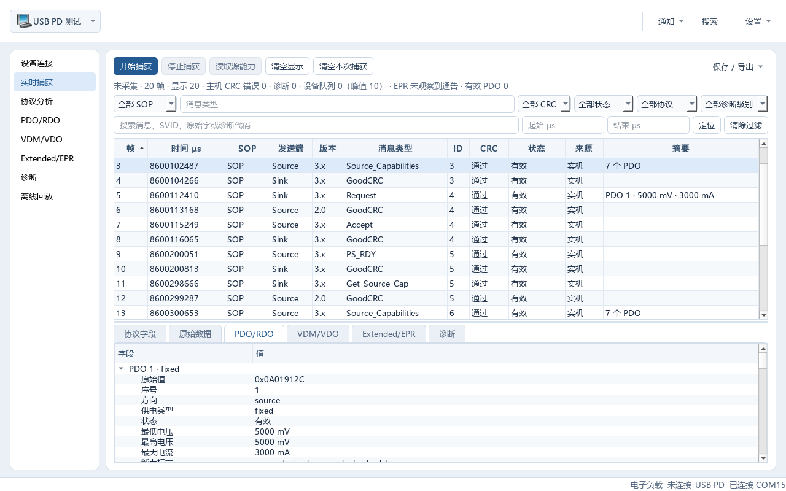

# 双工作区设计

应用沿用电子负载上位机的 Fusion 主题、字体、浅蓝灰背景、白色卡片、蓝色操作按钮与原有曲线配色。USB PD 页面使用同一套卡片、文本和状态样式。表格中的诊断颜色与文字状态配合显示。

## 切换与状态

| 操作 | 界面与服务行为 |
| --- | --- |
| 首次启动 | 打开电子负载工作区。原有工具栏、测量、图表和控制区可直接使用。 |
| 点击左上角按钮 | 菜单显示工作区名称、图标和用途，当前工作区高亮并勾选。 |
| 选择另一工作区 | 更新顶部标题和中央内容。USB PD 工作区显示专用导航，保留原页面、选择和筛选。已打开端口及运行中的任务继续。 |
| 打开两个设备 | 每个工作区通过自己的连接管理设备。端口被另一工作区占用时，拒绝重复打开并显示原因。 |
| 重启应用 | 恢复工作区和 USB PD 左侧页面，以及 DRPD 端口选项、跟随设置和最近的文件目录。两个串口等待手动连接。 |

`QSettings` 使用 `workspace/active`、`pd/page`、`pd/port`、`pd/auto_follow`、`pd/open_dir` 和 `pd/export_dir` 保存界面偏好。采集运行状态、设备回读和选中记录属于当前会话。

## 参考图

工作区选择器。

DRPD 已连接，当前显示电子负载界面。状态栏显示后台捕获。

同一程序的 USB PD 实时捕获界面。

[界面要求](P3_UI_REQUIREMENTS.md) · [第三阶段验收报告](DRPD_第三阶段验收报告.md)
